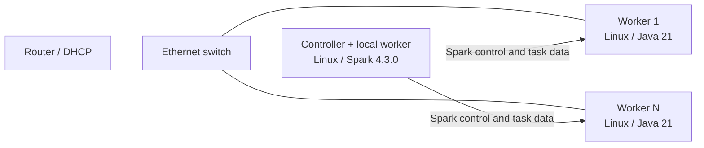

# Distributed Epsilon benchmark with Apache Spark

A reproducible, small-team cluster project for scanning the LIBSVM Epsilon training set across Linux hosts on a wired LAN. Spark schedules partitions across worker machines; a Scala application reports the records, labels, feature values, partitions, and hosts that processed them.

This is a distributed data-processing demonstration. It does not train a predictive model. Source code and configuration are versioned; Spark binaries and the multi-gigabyte dataset are downloaded by the setup scripts and are intentionally kept out of Git.

## At a glance

- Apache Spark **4.3.0**, Scala **2.13**, OpenJDK **21** (pinned runtime).
- Debian 13 or Ubuntu 24.04 LTS, x86-64, on the controller and workers.
- One controller that also runs an executor, plus one or more workers.
- Gigabit Ethernet recommended; all nodes must be able to connect to each other directly.
- The controller should have **16 GiB** free while fetching and unpacking the dataset; each worker should have **10 GiB** free for the staged dataset and Spark runtime.
- No Python ML stack, Conda, Maven, or separately installed Scala is required. Scala compiler and Spark libraries come from the pinned Spark distribution.

## Topology



Use DHCP reservations for stable LAN addresses where possible. Do not choose an address already assigned by the router. `MASTER_HOST` and each worker's LAN address belong in the ignored local file `cluster.env`; the repository template contains documentation examples, not the author's home-network addresses.

## Requirements

### Controller

- Debian 13 or Ubuntu 24.04 LTS, x86-64.
- JDK 21, Git, Bash, `curl`, `tar`, `bzip2`, `rsync`, OpenSSH client, `python3`, and `sha512sum`.
- Internet access for the initial Spark and dataset downloads.
- At least 2 CPU cores and 16 GiB free disk recommended for the full-data download and extraction.

### Each worker

- Debian 13 or Ubuntu 24.04 LTS, x86-64, Java 21 runtime, `rsync`, and OpenSSH server.
- At least 2 CPU cores and 10 GiB free disk recommended. More memory and disk may be needed for concurrent jobs.
- Key-based SSH from the controller and direct TCP connectivity to the controller and other workers.

The setup scripts install packages with `apt`. On other distributions, install the equivalent packages and follow the same environment-variable and SSH setup.

## Quick start

### 1. Get the source and prepare machines

On the controller:

```bash
sudo apt update
sudo apt install -y git curl tar bzip2 rsync openssh-client python3 openjdk-21-jdk
git clone https://github.com/AloHerdz/spark-epsilon-cluster.git
cd spark-epsilon-cluster
cp cluster.env.example cluster.env
```

On every worker, from its local terminal or an existing remote management channel:

```bash
git clone https://github.com/AloHerdz/spark-epsilon-cluster.git
cd spark-epsilon-cluster
sudo bin/bootstrap-debian worker
```

The worker does not need a separate GitHub account or clone for routine cluster operation; `bin/start-cluster` copies the required runtime and project files from the controller. This manual clone is only needed for the one-time bootstrap script. Alternatively, install `openjdk-21-jre-headless`, `openssh-server`, and `rsync` with the system package manager and start the SSH service.

On the controller, copy its public SSH key to each worker and add a host alias to `~/.ssh/config`:

```sshconfig
Host worker1
    HostName 192.168.1.20
    User YOUR_LINUX_USER
    IdentityFile ~/.ssh/id_ed25519
    IdentitiesOnly yes
```

Then authorize the key and check connectivity:

```bash
ssh-copy-id worker1
ssh worker1 'hostname; java -version; ip -brief -4 address'
```

Repeat with aliases `worker2`, `worker3`, and so on when adding hosts. Use the address on the wired interface connected to the same LAN.

For key creation, Debian SSH server setup, file permissions, and passwordless aliases such as `ssh worker1`, see [`docs/ssh-access.md`](docs/ssh-access.md). Each teammate keeps their own addresses and Linux usernames in their local `~/.ssh/config`.

### 2. Set the LAN configuration

Edit `cluster.env` on the controller. Example for one worker:

```bash
MASTER_HOST=192.168.1.10
WORKER_HOSTS=worker1
WORKER_IPS=worker1=192.168.1.20
LOCAL_CORES=2
LOCAL_MEMORY=2048m
WORKER_CORES=2
WORKER_MEMORY=2048m
```

For two workers, use comma-separated entries in the same order:

```bash
WORKER_HOSTS=worker1,worker2
WORKER_IPS=worker1=192.168.1.20,worker2=192.168.1.21
```

Change the example addresses to match the addresses actually assigned on the lab network. The `WORKER_HOSTS` values must match the SSH aliases. `WORKER_IPS` maps each alias to the worker's wired LAN address. Check for duplicate addresses before running the cluster.

### 3. Install the pinned runtime and make a smoke dataset

```bash
bin/bootstrap-debian master    # Optional if dependencies above are already installed
bin/install master
bin/make-sample 512
bin/stage sample
bin/start-cluster
bin/observe
bin/submit sample | tee results/sample-run.log
bin/stop-cluster
```

`bin/install master` downloads the Spark 4.3.0 distribution, checks it against the SHA-512 file from Apache's distribution server, and compiles the Scala application. Spark 4.x uses Scala 2.13; the compiler version bundled with the downloaded Spark release is used. This project pins Java 21, which is supported by Spark 4.3.0 and is available in Debian 13 and Ubuntu 24.04 package repositories. It can take several minutes on the first run. The `SPARK_DOWNLOAD_BASE` setting can select a nearby binary mirror; checksum verification always uses Apache's distribution server. The smoke dataset validates the cluster path and the two-host distribution requirement before the larger download.

### 4. Download and process Epsilon

On the controller:

```bash
bin/fetch-epsilon
bin/stage epsilon
bin/start-cluster
bin/observe
bin/submit epsilon | tee results/epsilon-run.log
bin/stop-cluster
```

The script first tries the official LIBSVM `epsilon_normalized.bz2` training file. If it is unavailable, it downloads the 20 training Parquet shards from a pinned Hugging Face revision and verifies each file's SHA-256 from [`conf/epsilon-hf-train.tsv`](conf/epsilon-hf-train.tsv). Parquet reads directly in Spark. A ten-row spot comparison against CatBoost's LIBSVM-derived copy matched all 2,000 features in each row; negative labels are encoded as `0` instead of `-1`, so this appears to be a converted copy of the same split. If Hugging Face is unavailable, the script falls back to CatBoost's checksum-pinned TSV archive. `bin/stage epsilon` sends the selected dataset to each worker and uses a local `file:///` path on every machine. The Scala job reads LIBSVM, TSV, or Parquet, checks 400,000 rows and 2,000 features per row, and reports the hosts that processed partitions.

## Monitoring and network

| View | Default URL | Shows |
|---|---|---|
| Spark master | `http://MASTER_HOST:8080` | Registered workers and cluster capacity |
| Spark application | `http://MASTER_HOST:4040` | Jobs, stages, task count, and executor activity while the job is running |
| Worker 1 | `http://WORKER1_IP:8081` | Worker status and allocated resources |

The scripts use Spark Standalone ports `7077` (master), `7078` (worker), `8080` (master UI), and `8081` (worker UI). The example job sets driver ports `37071` and `37072` and UI port `4040`. Allow those connections on the trusted lab LAN; Spark Standalone has no authentication enabled in this setup. Do not expose these ports to the public Internet.

Wireshark can capture traffic visible on the controller's interface. Example display filter:

```text
tcp.port == 7077 || tcp.port == 7078 || tcp.port == 37071 || tcp.port == 37072
```

An ordinary unmanaged switch forwards unicast traffic only to the ports that need it. To capture traffic exchanged directly between other nodes, use a managed switch with port mirroring or capture on those nodes. The Spark UIs and the `PART` lines in the job output show task distribution without packet capture.

## Project layout

```text
src/                    Scala processing and smoke-data programs
bin/                    Setup, download, staging, monitoring, and run scripts
conf/spark-version      Pinned Spark release
conf/java-version       Pinned Java major version
conf/epsilon-hf-train.tsv  Pinned Parquet shard sizes and checksums
cluster.env.example     Local network configuration template
data/                   Downloaded dataset and generated smoke data (ignored)
runtime/                Downloaded Spark libraries and checksum manifest (ignored)
results/                Local run logs (ignored)
```

The reproducible lab sequence is in [`docs/lab-runbook.md`](docs/lab-runbook.md); reusable SSH setup is in [`docs/ssh-access.md`](docs/ssh-access.md). Host-specific addresses and aliases stay in the ignored local `cluster.env`.

## Reproducibility notes

- The Spark version and checksum verification are fixed in the source scripts.
- System package versions can differ by distribution mirror and date; record `java -version`, `uname -a`, and each node's IP alongside experiment output.
- Keep the generated `cluster.env`, dataset, Spark binaries, SSH keys, and private logs out of Git. `.gitignore` already excludes the local configuration and downloaded artifacts.
- The smoke run uses 512 deterministic rows and requires at least two hosts. Epsilon uses the original 400,000-row training set.
- The CatBoost fallback is a checksum-pinned conversion of the LIBSVM Epsilon training split. The Hugging Face Parquet mirror is pinned by commit and per-file SHA-256; the first 10 rows were compared against the CatBoost conversion, with identical feature values and the negative-label mapping from `-1` to `0`.
- To use another number of workers, add SSH aliases and update `WORKER_HOSTS` / `WORKER_IPS`; no script contains a machine-specific hostname.

## Data citation

The original training set is documented by the [LIBSVM dataset repository](https://www.csie.ntu.edu.tw/~cjlin/libsvmtools/datasets/binary.html). The faster Parquet mirror is the public [Hugging Face `jxie/epsilon` dataset](https://huggingface.co/datasets/jxie/epsilon), pinned to revision `964bc24a366c0204aaab5c560cccb3d236b2495f` with per-shard SHA-256 values in the manifest. Preserve the original dataset terms when using the data.
